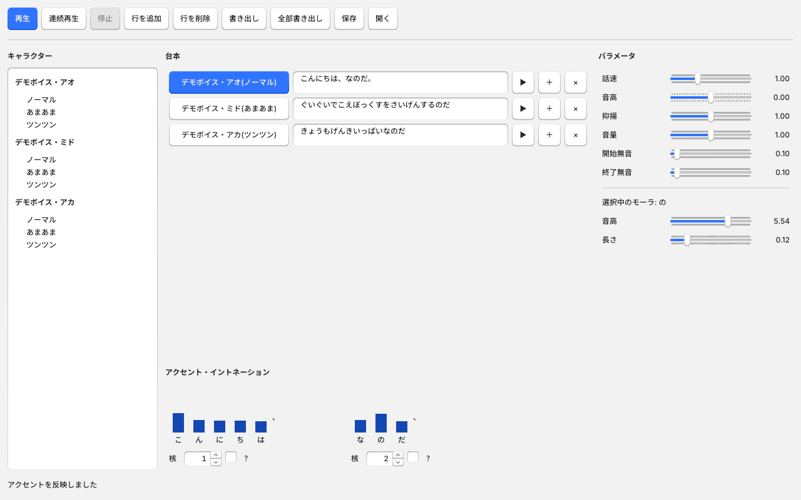

# nanoda VOICEVOX

[guigui](https://github.com/guigui-gui/guigui) と [nanoda](https://github.com/aethiopicuschan/nanoda) だけで、[VOICEVOX](https://voicevox.hiroshiba.jp/) のエディタを再現したデスクトップアプリケーションです。



VOICEVOXのエディタと同じく、以下を1画面で行き来できます。

- **キャラクター一覧**(左) — 話者とスタイルを選ぶ
- **台本**(中央) — 行ごとにキャラクターとテキストを持ち、行単位で再生できる
- **アクセント・イントネーション**(下) — モーラごとの音高を棒グラフで見せ、アクセント核の位置と疑問形を切り替えられる。棒をクリックするとそのモーラを選べる
- **パラメータ**(右) — 話速・音高・抑揚・音量・開始無音・終了無音。モーラを選んでいるときは、そのモーラの音高と長さも調整できる

ツールバーからは、選択行の再生・全行の連続再生・停止・行の追加と削除・WAVの書き出し・台本の保存と読み込みができます。

## 動かす

このディレクトリは親ディレクトリのnanodaとは別のGoモジュールです。ライブラリ側に
guiguiやEbitengineへの依存を持ち込まないようにするためで、`go.mod` の `replace` で
同じリポジトリのnanodaを見ています。

### VOICEVOX CORE を使う

```sh
cd apps/voicevox
go run . \
  -core   /path/to/voicevox_core.dll \
  -dict   /path/to/open_jtalk_dic_utf_8-1.11 \
  -models /path/to/models
```

`-core` / `-dict` / `-models` は、それぞれ環境変数 `NANODA_CORE` / `NANODA_DICT` /
`NANODA_MODELS` でも指定できます。必要なファイルの用意の仕方は
[VOICEVOX CORE](https://github.com/VOICEVOX/voicevox_core) のREADMEを参照してください。
`0.16` 系ではONNX Runtimeをコアライブラリと同じディレクトリに置く必要があります。

### VOICEVOX CORE が無いとき(デモエンジン)

```sh
cd apps/voicevox
go run .
```

`-core` を省略すると、仮名を読んで正弦波で鳴らすだけのデモエンジンで起動します。
VOICEVOXの音声を再現するものではありませんが、画面と操作はひととおり確かめられます。
上のスクリーンショットもデモエンジンのものです。

### そのほかのオプション

| オプション | 既定値 | 説明 |
| --- | --- | --- |
| `-out` | `voicevox-out` | WAVと台本の書き出し先ディレクトリ |
| `-open` | (なし) | 起動時に開く台本ファイル(`.nvproj`) |

ファイル選択ダイアログは持っていません。「書き出し」「保存」「開く」はすべて
`-out` のディレクトリを使い、書き出した場所はステータスバーに出ます。

## VOICEVOX COREのバージョンと機能

nanodaは `0.15` 系(`github.com/aethiopicuschan/nanoda`)と `0.16` 系
(`github.com/aethiopicuschan/nanoda/v2`)で別系統になっており、公開しているAPIも
違います。このアプリは両方に依存し、読み込んだライブラリのバージョンを見て
使える機能を切り替えます。バージョンの判定は `v2` に任せ、`0.16` 系でないと
言われたら `0.15` 系として開きなおします(逆順に試すと、`0.16` 系のコアに対して
`0.15` 系の実装が存在しないシンボルを引きに行ってしまいます)。

| | 0.15系 (nanoda) | 0.16系 (nanoda/v2) | デモ |
| --- | --- | --- | --- |
| テキストからの音声合成 | ○ | ○ | ○ |
| キャラクター一覧 | ○ | — | ○ |
| AudioQuery(話速・抑揚など) | ○ | — | ○ |
| アクセント句の編集 | ○ | — | ○ |

Windowsでは `0.15` 系を開けません。`0.15` 系のnanodaは`purego.Dlopen`を直接呼んでおり、
これがWindowsに無いためです(`0.16` 系のnanoda/v2は内部にWindows用のライブラリ読み込みを
持っています)。Windowsで使う場合は `0.16` 系のコアライブラリを指定してください。

`0.16` 系ではAudioQuery・アクセント句・メタ情報の取得がまだnanodaに移植されて
いない([対応状況](https://github.com/aethiopicuschan/nanoda#対応状況016x--このv2ブランチ))
ため、キャラクター一覧の代わりにスタイルIDを直接指定する欄が出て、パラメータ欄と
アクセント欄は理由を表示します。nanoda側が対応したら、`internal/voice/nanoda016.go`
に `internal/voice/nanoda015.go` と同じ実装を足すだけでエディタとして完全になります。

## 構成

```
main.go                     フラグの解釈とguigui.Runの呼び出し
internal/voice/             エンジンの抽象と実装
  voice.go                    Engine/Query/AccentPhrase と Capabilities
  open.go                     バージョンを見てエンジンを選ぶ
  nanoda015.go                VOICEVOX CORE 0.15系
  nanoda016.go                VOICEVOX CORE 0.16系
  demo.go, kana.go, wav.go    COREなしで動くデモ実装
internal/project/           台本(行・スタイル・AudioQuery)とJSONの読み書き
internal/player/            Ebitengineのオーディオで合成結果を鳴らす
internal/ui/                guiguiのウィジェット群
  app.go                      画面全体で共有する状態と、合成の非同期実行
  root.go                     ウィンドウの骨組み
  toolbar.go / characters.go / script.go / params.go / accent.go
```

音声合成はワーカーゴルーチン1本に直列化して投げ、結果はチャネルで
メインゴルーチンに戻してから反映しています。VOICEVOX COREの呼び出しは
ゴルーチンセーフとは限らず、また合成には時間がかかるため、UIを止めない
ようにするためです。

## テスト

```sh
cd apps/voicevox
go test ./...
```

エンジンの抽象(仮名の解析、アクセントと音高の対応、WAVの組み立て)と
台本の編集・保存を対象にしています。画面まわりは
[Ebitengineのヘッドレス実行](https://github.com/hajimehoshi/ebiten/tree/main/skills/run-ebitengine-app-headless)
で確認できます。

このディレクトリは別モジュールなので、リポジトリ直下の `go test ./...` には
含まれません。CIで一緒に見るなら `.github/workflows/ci.yml` に次のジョブを
足してください。

```yaml
  app:
    needs: lint
    runs-on: ubuntu-latest

    steps:
      - uses: actions/checkout@v4

      - name: Setup Go
        uses: actions/setup-go@v4
        with:
          go-version-file: "apps/voicevox/go.mod"

      - name: Build
        working-directory: apps/voicevox
        run: go build ./...

      - name: Test
        working-directory: apps/voicevox
        run: go test ./...
```

## ライセンスと利用規約

このアプリ自体はリポジトリと同じくMITライセンスですが、実際に音声を作る場合は
VOICEVOXやOpenJTalkの利用規約、および音声モデル(VVMファイル)ごとの
キャラクター利用規約に従ってください。
